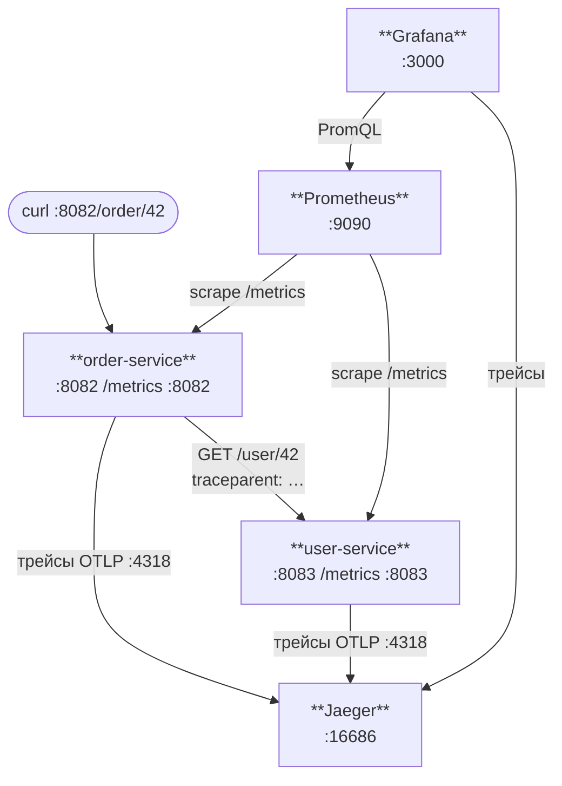

# task04. Мини-проект: два сервиса, один trace

В реальном мире у тебя не один сервис, а десятки. Один запрос от пользователя проходит через пять-семь из них. И когда что-то тормозит - тебе нужно видеть весь путь **целиком**, как одно дерево.

В этой задаче ты сделаешь ровно это: два Go-сервиса (`order-service` и `user-service`), один дёргает другой по HTTP, и весь маршрут складывается в один trace в Jaeger. А метрики разделяются по лейблу `service`, и в Grafana ты увидишь RPS/p95/errors в разрезе каждого сервиса.

Это полноценная модель продакшена - только без k8s, чтобы не усложнять.

---

## Архитектура



**order-service** (`:8082`) принимает запросы, валидирует, ходит за пользователем в другой сервис, возвращает "заказ".

**user-service** (`:8083`) отвечает на `/user/{id}`, имитирует поход в БД.

---

## Что лежит в проекте

В каждом сервисе три файла:
- `main.go` - бизнес-логика + **по одному TODO** на каждый сервис: зарегистрировать handler с middleware.
- `obs.go` - **готовая** обвязка observability: метрики RED, `initTracer`. Её трогать не надо.
- `go.mod` - зависимости.

Почему obs.go уже написан: в task01 и task03 ты это уже проходил, тут бы только механически повторил. Лучше сосредоточься на новом - как связать два сервиса в один trace.

Кроме TODO, в order-service/main.go уже написан готовый `httpClient` с `otelhttp.NewTransport` - это ключевой механизм задачи. Прочитай раздел "2. В order-service" ниже, чтобы понять зачем он именно такой.

---

## Что делаешь

### 1. В user-service (main.go)

Регистрируешь `/user/{id}` с двумя обёртками:
```go
userH := otelhttp.NewHandler(
    metricsMiddleware(http.HandlerFunc(userHandler)),
    "GET /user/:id",
)
mux.Handle("/user/", userH)
```

**Порядок важен.** `otelhttp` - снаружи, `metricsMiddleware` - внутри. Почему:
- `otelhttp` при входящем запросе читает `traceparent`-заголовок и создаёт корневой спан. Этот спан доступен через `r.Context()`.
- Если `metricsMiddleware` окажется снаружи, он увидит запрос **до** создания спана. В принципе ему это не важно (он считает только длительность и статус), но по соглашению трейсинг всегда внешний.

### 2. В order-service (main.go)

**Твой TODO** — зарегистрировать `orderHandler` с теми же двумя обёртками, что и в user-service:
```go
orderH := otelhttp.NewHandler(
    metricsMiddleware(http.HandlerFunc(orderHandler)),
    "GET /order/:id",
)
mux.Handle("/order/", orderH)
```

**Главная фишка задачи** — уже написанный за тебя `httpClient`:
```go
httpClient := &http.Client{
    Transport: otelhttp.NewTransport(http.DefaultTransport),
    Timeout:   2 * time.Second,
}
```

Именно `otelhttp.NewTransport` делает так, что при каждом вызове user-service к запросу автоматически прикрепляется заголовок `traceparent`. Без него user-service не узнает, что это продолжение того же trace-а.

**Если забыть** и использовать `http.DefaultClient.Do(req)` - заголовок не добавится, в Jaeger увидишь **два** отдельных trace-а. Это самая частая ошибка при внедрении трейсинга.

---

## Запуск

> **Важно:** order-service использует порт `:8082` — тот же, что и сервис из task03.
> Если task03 ещё запущен, останови его (`Ctrl+C`) перед стартом task04.

Нужно три терминала (плюс инфра в фоне):

```bash
# Терминал 1 - инфра (можно в фоне)
docker compose up -d

# Терминал 2 - user-service
cd task04-project/user-service
go mod tidy
go run main.go

# Терминал 3 - order-service
cd task04-project/order-service
go mod tidy
go run main.go

# Терминал 4 - нагрузка
hey -z 2m -c 20 http://localhost:8082/order/42
```

---

## Что проверить

### 1. Prometheus видит оба сервиса

Открой http://localhost:9090/targets. И `order-service`, и `user-service` должны быть `UP`. Если какой-то `DOWN` - посмотри в "Error" колонке.

### 2. Метрики разделяются по сервису

В Grafana или в http://localhost:9090/graph:
```promql
sum by (service) (rate(http_requests_total[1m]))
```

Лейбл `service` навешивается не в коде, а в конфиге Prometheus (смотри [`infra/prometheus.yml`](../infra/prometheus.yml) - там `labels: {service: order}`). Это называется "target label" - удобно для всяких мета-группировок без правки сервиса.

### 3. Сквозной trace в Jaeger

http://localhost:16686:
1. Выбираешь в дропдауне `order-service`.
2. Find Traces.
3. Клик по любому trace. Должен увидеть:
   ```
   order-service: HTTP GET /order/:id          180ms
     ├── order-service: validateOrder            1ms
     └── order-service: fetchUser              170ms
           └── order-service: HTTP GET          165ms  (клиентский спан от otelhttp.Transport)
                 └── user-service: HTTP GET /user/:id  160ms
                       └── user-service: callDB        150ms
   ```

Если видишь два отдельных trace (один в `order-service`, один в `user-service`) - **traceparent не передаётся**. Проверь:
- В order-service используешь инструментированный `httpClient` (с `otelhttp.NewTransport`)?
- В user-service мультиплексор обёрнут в `otelhttp.NewHandler`?
- `http.NewRequestWithContext(ctx, ...)` - именно WithContext, не просто NewRequest?

---

## Grafana-дашборд для двух сервисов

Повтори task02, но теперь с разбивкой по `service`:

```promql
# RPS по сервисам
sum by (service) (rate(http_requests_total[1m]))

# p95 по сервисам
histogram_quantile(0.95,
  sum by (le, service) (rate(http_request_duration_seconds_bucket[5m]))
)

# Error rate по сервисам
sum by (service) (rate(http_requests_total{status=~"5.."}[5m]))
  / sum by (service) (rate(http_requests_total[5m]))
```

В Legend ставь `{{service}}` - на графике будут две линии с подписями.

---

## Эксперименты

Это самое интересное. Делай их по одному:

### 1. Убей user-service (Ctrl+C)

Что происходит:
- В Grafana error-rate `order-service` взлетает до 100%.
- В `/targets` Prometheus-а `user-service` становится DOWN.
- В Jaeger trace-ы продолжают приходить от `order-service`, но клиентский спан `HTTP GET /user/...` становится красным - connection refused.

Подними обратно, посмотри как метрики возвращаются в зелёную зону.

### 2. Замедли user-service

В `callDB` user-service добавь `time.Sleep(500 * time.Millisecond)`. Перезапусти. Смотри:
- p95 `user-service` - взлетит.
- p95 `order-service` - тоже, почти на ту же величину (order почти всё время ждёт user-а).
- В trace: спан `callDB` теперь доминирует - сразу видно, что тормозит не order, а именно user.

Это и есть сила трейсинга. По метрикам ты бы видел, что "p95 order взлетел", но почему - непонятно. Trace показывает напрямую.

### 3. Добавь свой спан

В order-service между `validateOrder` и `fetchUser` добавь:
```go
_, span := tracer.Start(ctx, "enrichOrder")
time.Sleep(20 * time.Millisecond)
span.End()
```

В Jaeger увидишь новый узел между валидацией и походом в user-service.

### 4. Baggage - доп.данные через trace

Baggage - это key-value, которые путешествуют вместе с trace-context-ом. Удобно для передачи типа "tenant=acme" без правки всех API.

В order-service перед `fetchUser`:
```go
import "go.opentelemetry.io/otel/baggage"

b, _ := baggage.Parse("tenant=acme,user-id=" + id)
ctx = baggage.ContextWithBaggage(ctx, b)
```

В user-service в handler:
```go
b := baggage.FromContext(r.Context())
tenant := b.Member("tenant").Value()
fmt.Println("tenant:", tenant)
```

Baggage поедет по HTTP в отдельном заголовке автоматически - благодаря тому, что мы в `initTracer` настроили `propagation.Baggage{}`.

---

## Вопросы на подумать

1. Что будет, если в order-service использовать `http.DefaultClient` без обёртки? Как это проявится?
2. Как в user-service узнать "кто меня позвал" без явной передачи? (Подсказка: parent span context, semconv.PeerService.)
3. Почему метрики и трейсы - **не взаимозаменяемые** штуки? Приведи пример, когда одно есть, а другое не поможет.
4. Что такое **exemplars** в Prometheus? Как они связывают конкретный ряд метрики с конкретным trace-ом? (Не реализуем здесь, но это следующий уровень связности.)
